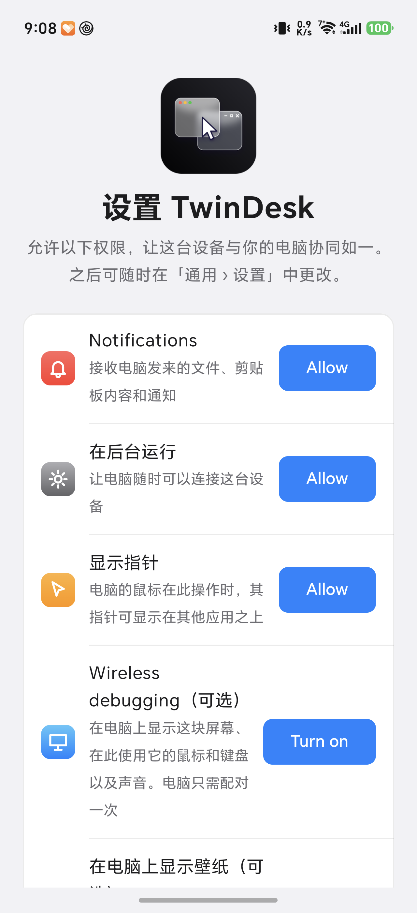
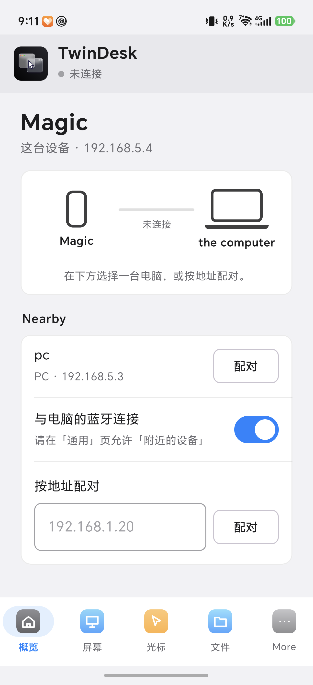
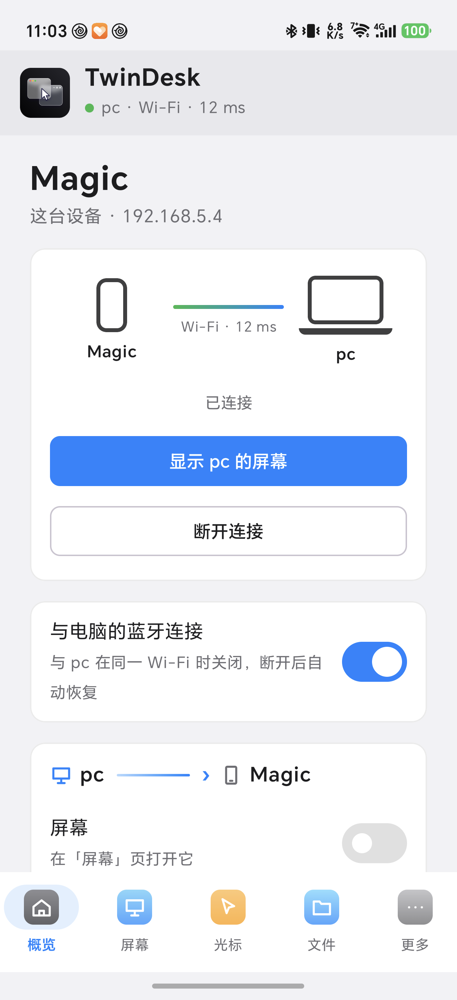
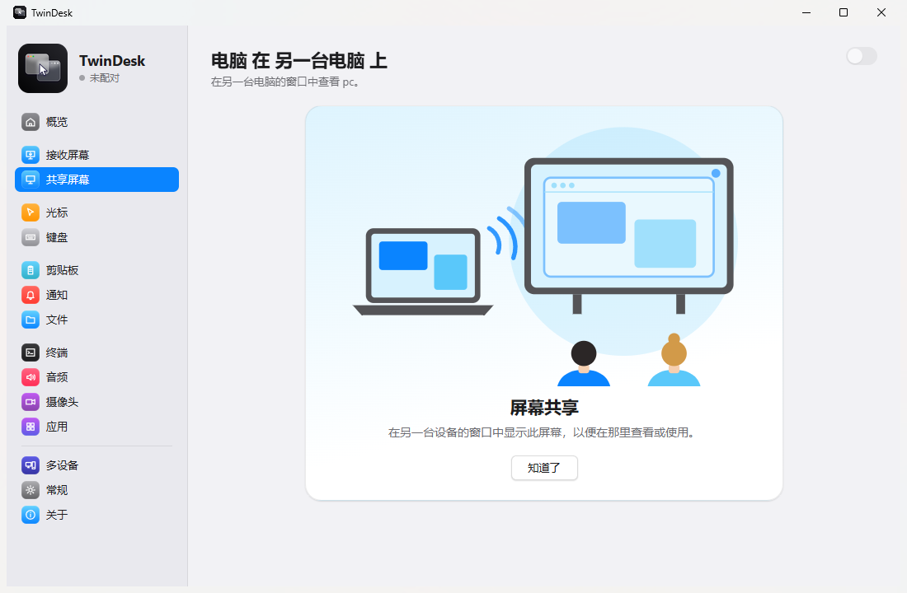
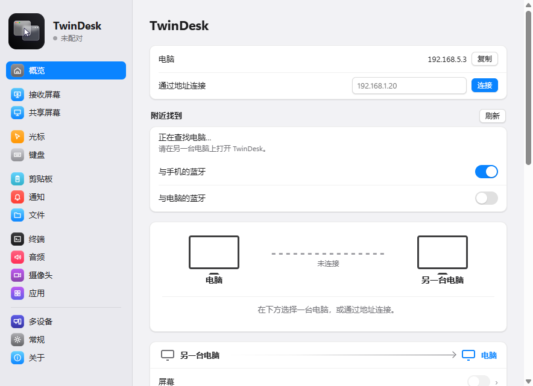
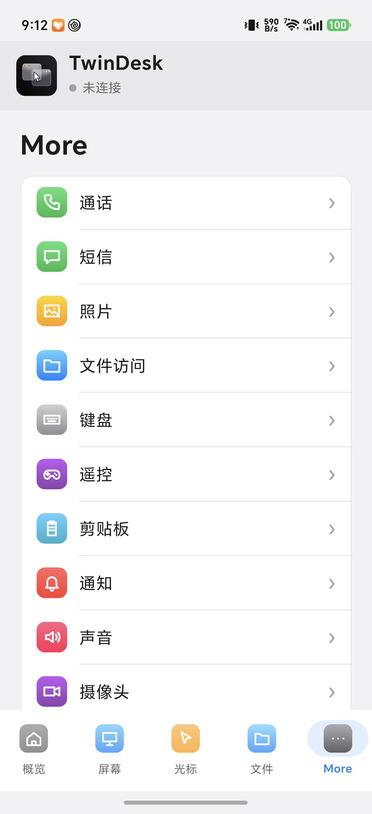
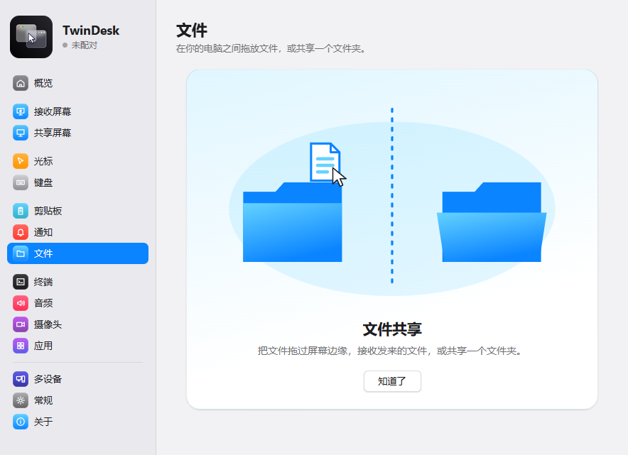
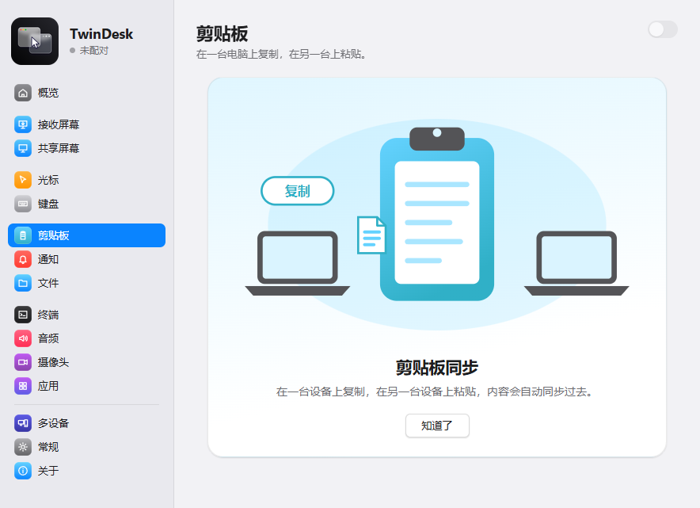
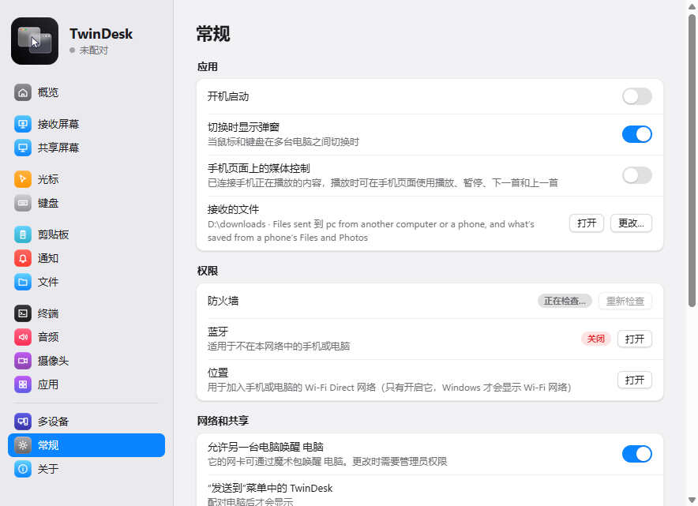

# TwinDesk 简体中文（非官方备份仓库）

> ⚠️ **非官方项目**。本仓库只是个人备份 + 汉化补丁/构建产物存档，**与 TwinDesk 作者无关**，不代表官方发布。
> 上游项目：[InukaAsith/TwinDesk](https://github.com/InukaAsith/TwinDesk)（GPL-3.0）

[TwinDesk](https://github.com/InukaAsith/TwinDesk) 2.4.0 的简体中文改造存档：**安卓源码编译版** + **Windows 运行时汉化补丁**。

## 截图预览

<table>
<tr>
<td align="center"><br><sub>安卓 · 首次授权向导</sub></td>
<td align="center"><br><sub>安卓 · 概览（已连接）</sub></td>
<td align="center"><br><sub>安卓 · 文件页</sub></td>
</tr>
<tr>
<td align="center"><br><sub>Windows · 主界面</sub></td>
<td align="center"><br><sub>Windows · 概览</sub></td>
</tr>
</table>

---

## 一、安卓版：下载与安装

### 1. 下载 APK

到 [Releases](https://github.com/hiddenyx/TwinDesk-zhCN/releases/tag/v2.4.0-zhCN) 下载：

| 文件 | 用途 |
|---|---|
| `TwinDesk-2.4.0-sourcebuild-zhCN.apk` | 中文版（要装的就是它） |
| `TwinDesk-2.4.0-sourcebuild-en.apk` | 英文对照版，仅用于验证构建可复现 |

SHA256（中文版）：`25266dba17123f25c77ee73da0fb88e970227c1c4819e38c3789a628808b9937`

### 2. 先卸载官方版（重要）

中文版与官方版**签名不同**，不能覆盖安装：

> 设置 → 应用 → TwinDesk → 卸载

⚠️ 卸载会丢失与电脑的配对信息，装好后需要重新配对一次。

### 3. 安装

1. 把 APK 传到手机（数据线 / 网盘 / 直接手机浏览器下载）
2. 点开 APK，系统提示「未知来源」时允许本次安装
3. 手机安全中心可能提示「风险应用 / 来历不明」——这是自签名安装包的常规提示，选择**继续安装**

### 4. 首次打开：按向导授权


| 项目 | 建议 |
|---|---|
| 通知 | **允许**（接收电脑发来的文件、剪贴板、通知） |
| 在后台运行 | **允许**（忽略电池优化，保持连接） |
| 显示指针 | **允许**（电脑的鼠标指针能显示在其他应用上） |
| 无线调试 | 可选，需要电脑远控手机屏幕时再开 |
| 壁纸 | 可选，需要共享壁纸时再给「所有文件访问」 |

### 5. 给「附近的设备」权限（配对的关键）

没有这个权限，手机和电脑会互相找不到：

> 底部 **更多** → **常规** → 往下拉到「附近的设备」→ **允许** → 弹窗选 **始终允许**

### 6. 与电脑配对

1. 手机：**概览** → 「附近」里出现你的电脑（显示 `PC · Bluetooth`）→ 点 **配对**
2. 电脑：TwinDesk 窗口弹出「XXX 请求配对」，核对两端显示的 **6 位配对码**是否一致
3. 电脑点 **允许**，手机点 **配对码一致**
4. 连接成功：手机显示 `pc · Wi-Fi · 十几 ms`，电脑侧边栏出现手机图标



| 功能 | 说明 |
|---|---|
| 屏幕 | 在手机上显示电脑屏幕，或把手机当第二屏幕 |
| 光标 | 把电脑鼠标移出屏幕边缘，接着在手机上操作 |
| 文件 | 双向发送文件、拖放传输、剪贴板复制粘贴 |
| 更多 → 通话/短信/照片/文件访问/通知/声音/摄像头 | 手机与电脑之间的各类互通 |

---

## 二、Windows 版：汉化补丁

Windows 桌面版没有多语言支持，本补丁**不修改安装包**，通过运行时注入中文词典实现汉化，可一键还原。

### 1. 下载并解压

到 [Releases](https://github.com/hiddenyx/TwinDesk-zhCN/releases/tag/v2.4.0-zhCN) 下载 `twin-desktop-zhCN-patch.zip`，解压到任意目录（例如 `D:\TwinDesk-zhCN-patch`）。

### 2. 打补丁（需要管理员权限）

TwinDesk 默认装在 `C:\Program Files\TwinDesk`，修改 `resources\app` 需要管理员：

1. 开始菜单搜索 **PowerShell** → 右键 **以管理员身份运行**
2. 执行：

```powershell
cd D:\TwinDesk-zhCN-patch
powershell -ExecutionPolicy Bypass -File .\scripts\apply.ps1
```

脚本会：备份原始文件 → 安装中文词典/引擎 → 注入 11 个页面与 2 个主进程文件 → 自动重启 TwinDesk。

### 3. 效果

<table>
<tr>
<td align="center"><br><sub>概览页</sub></td>
<td align="center"><br><sub>文件页</sub></td>
</tr>
<tr>
<td align="center"><br><sub>剪贴板页</sub></td>
<td align="center"><br><sub>常规设置</sub></td>
</tr>
</table>

### 4. 还原英文

```powershell
cd D:\TwinDesk-zhCN-patch
powershell -ExecutionPolicy Bypass -File .\scripts\undo.ps1
```

### 5. 注意事项

- TwinDesk **升级/重装**会覆盖 `resources\app`，补丁失效，需要重新执行 `apply.ps1`（脚本是幂等的）。
- 补丁只替换界面文本，不改业务逻辑；卸载 TwinDesk 时恢复原文件即可。

---

## 三、常见问题

**Q：手机找不到电脑 / 电脑找不到手机？**

1. 确认手机已给「附近的设备」权限（见上文第 5 步）
2. 确认两端在同一 Wi-Fi，且电脑没有同时启用有线+无线两个同网段网卡（会回包错乱）
3. 蓝牙没开也能局域网配对，但建议保持蓝牙开启，跨网络时走蓝牙
4. 仍不行：在电脑上点「按地址配对」，输入手机显示的 IP

**Q：配对码对不上 / 配对超时？**

- 两端各自重新发起一次配对，确保看到的是同一轮的码
- 时间不同步、Clash 等代理软件的 TUN 模式可能干扰局域网回包，先关掉再试

**Q：APK 装不上，提示「应用未安装 / 签名冲突」？**

- 先卸载官方版（签名不同，不能覆盖）
- 仍有问题：`adb uninstall com.twindesk.android` 后再装

**Q：手机安全中心报「风险应用」？**

- 自签名、重打包应用的常规提示；本仓库的 APK 由源码编译，内容哈希与官方包一致可自证（见 [docs/reproducibility.md](docs/reproducibility.md)）

**Q：手机升级后汉化没了？**

- 本汉化是修改版 APK，不会跟随官方更新；上游发版后需要重新编译/移植

---

## 四、仓库结构与实现

| 目录 | 内容 |
|---|---|
| `android/` | v2.4.0 修改后完整源码（Kotlin 界面字符串汉化 600+ 处）+ 汉化脚本 + 构建产物 |
| `android/patches/` | 8 个汉化脚本、英中对照表、残留英文扫描工具 |
| `windows/` | 运行时汉化补丁：词典（949 整句 + 296 模板）、引擎、主进程钩子、一键安装/还原 |
| `windows/trans/` | 8 批翻译源数据（英→中对照） |
| `docs/` | 源码编译说明、可复现性验证、截图、第三方许可 |

### 可复现性

本机从 `v2.4.0` 源码编译的英文 APK，与官方 Release 包对比：
`classes.dex`、`classes2.dex`、`resources.arsc`、`AndroidManifest.xml`、`lib/*.so` 的 **SHA256 完全一致**（仅签名与 zip 元数据不同）。
说明本仓库的中文版只是改了界面字符串，没有夹带其他代码。详见 [docs/reproducibility.md](docs/reproducibility.md)。

### 自己编译

```powershell
# 需要 JDK 21 + Android SDK（platforms;android-37.0、build-tools;37.0.0）
cd android
.\gradlew assembleStandardRelease
# 产物：app\build\outputs\apk\standard\release\app-standard-release.apk
```

---

## 五、许可与免责

- 本仓库是 TwinDesk 的衍生作品，整体按 **GPL-3.0** 发布，见 [LICENSE](LICENSE)。
- 上游版权归原作者（InukaAsith）所有；第三方组件许可见 [docs/THIRD_PARTY_NOTICES.txt](docs/THIRD_PARTY_NOTICES.txt)。
- 未获得使用 TwinDesk 名称/图标作为官方标识的授权；本仓库不暗示官方背书。
- 仅供个人备份与学习，按「现状」提供，不提供担保；修改版可能与上游后续版本不兼容。
- TwinDesk 具备屏幕共享、输入控制、通知/短信等敏感能力，请只在可信设备与网络中使用。